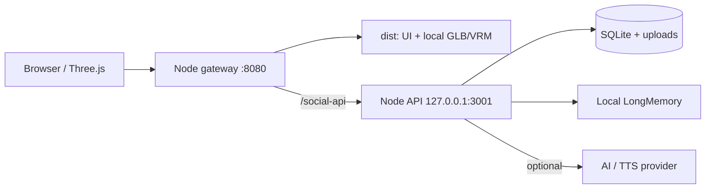

# Uoya · Release v1.0

[中文](#中文) · [English](#english) · [日本語](#日本語)

| 文档 / Documents / ドキュメント | 内容 / Purpose / 内容 |
| --- | --- |
| [DEPLOYMENT.md](DEPLOYMENT.md) | 中英日部署规范 / Trilingual deployment standard / 3言語のデプロイ規約 |
| [AI_DEPLOYMENT_PROMPT.md](AI_DEPLOYMENT_PROMPT.md) | 给 AI 部署助手的提示词 / AI operator prompts / AI 作業者向けプロンプト |
| [Security review](SECURITY_REVIEW.md) | 安全修复与实测记录 / Security validation / セキュリティ検証 |

## 中文

Uoya是可自托管的 3D 住宅与共享 AI 室友应用：Three.js 浏览器场景、多人群聊、一个共享 AI、生活模拟和管理员控制台在同源入口内协作。当前版本为 1.0.0；界面主要为中文，本文档提供三种语言，**不代表运行界面已完成三语国际化**。

### 架构与数据流




- **3D 前端**：Three.js、VRM、住宅布局、碰撞、门、照明、角色动作与自主生活执行。25 个家具 GLB 已本地化并校验 SHA-256，角色 VRM 也是本地资源；手机布局使用独立适配、SVG 图标和自定义选择控件。
- **共享社交服务**：Node.js 原生 HTTP、SQLite、Cookie 会话、SSE 消息流；账号、入群审核、成员权限、媒体上传和管理操作由后端校验。
- **AI 与动作**：配置可选模型服务，支持兼容 Chat Completions / Responses 的适配路径与流式回复。生活和场景行为通过受控工具、队列及浏览器执行页完成；文字承诺不等同于动作完成。无可见浏览器时，后端不能替代 WebGL 执行角色动作。
- **生活系统**：角色和玩家钱包、背包、生活数值与交易隔离，服务端维护事务、幂等和动作完成结算；静态商品目录不是历史用户数据。
- **记忆**：LongMemory 使用本地嵌入与 SQLite，索引真人聊天和允许公开的 AI 生活事件。房间身份持久化，不依赖部署路径；重置隔离长期记忆和近期上下文，取消当前回复，但不物理删除聊天或归档记忆。

### 目录

```text
src/                         Three.js world, avatar, controls, application UI
public/social-chat/          Chat and admin UI
public/life/                Shop and inventory UI
public/ui/                  Shared SVG icons, mobile styles, custom controls
public/assets/              Local furniture GLB and character VRM
server/social-chat/src/     Auth, chat, SSE, AI, memory, moderation, network
server/life/src/            Wallets, inventory, life rules and tool execution
LongMemory-main/            Locally supplied upstream engine source
scripts/                    Build, gateway, lifecycle and verification
tests/                      Frontend/domain and integration tests
dist/                       Rebuilt frontend; never contains runtime data
```

### 状态、依赖与边界


开发使用 npm run dev；首次启动仍须提供管理员凭证，只有明确 NODE_ENV=development 且后端绑定回环时允许开发初始化。npm run build 校验本地资源并生成 dist，npm start 提供正式网关。npm run preview 仅预览前端，不能代替完整后端。完整操作见部署文档。

验证入口：npm test、npm run test:chat、npm run test:life、npm run test:network。容器验收为 node scripts/test-container.mjs，使用随机临时数据、证书与网络，覆盖 TLS 拒绝、真实隧道和重建持久化；需要 Docker 及相关测试镜像。真机 Safari、实际 AI 服务和目标 VPS/DNS/TLS 仍需现场验收。


## English

Uoya is a self-hosted 3D home and shared AI roommate application. A Three.js scene, multi-user chat, one shared AI, a life simulation and an admin console work through the same origin. The current version is 1.0.0. The application UI is primarily Chinese; these trilingual documents **do not imply a fully localized UI**.

### Architecture and data flow


- **3D client**: Three.js/VRM, layout, collisions, doors, lighting, avatar actions and autonomous-life execution. All 25 furniture GLBs and the VRM are local. Builds verify furniture SHA-256 provenance. Mobile layouts use SVG icons and custom controls.
- **Social backend**: Native Node.js HTTP, SQLite, Cookie sessions and SSE. The server enforces authentication, membership review, roles, media access and administrative permissions.
- **AI and actions**: Optional external providers use supported Chat Completions / Responses adapters and streaming. Controlled tools, queues and a browser execution page perform actions; a written claim is not execution evidence. A backend container cannot replace the visible WebGL page for avatar actions.
- **Life system**: Separate player/AI wallets, inventories and simulated needs, with transactions, idempotency and completion-based settlement. The built-in shop catalog is static program data.
- **Memory**: Local embeddings and SQLite in LongMemory index human chat and permitted public AI life events. Persistent room identity survives path changes. Reset excludes old long-term memory and recent chat context and cancels the current reply; chat and archived memory are retained, not physically erased.

### Source map and runtime state

The directory tree above is the shared source map. src is the 3D application; public contains standalone chat/life/admin UI and local assets; server/social-chat handles sessions, chat, AI, memory and networking; server/life owns simulation and transactions. scripts manages builds and the gateway, deployment contains templates, tests contains regression coverage, and dist is frontend output.

The clean release includes no users, chat, memory databases, uploads, API keys or tunnel credentials. The default AI name is AI; avatar, description, persona and provider settings are blank. AI is disabled and welcome coins default to zero. First-run databases, encryption keys, uploads and network state must be persisted and backed up.


npm run dev starts development services. Initial owner credentials are still required unless local loopback development is explicitly enabled with NODE_ENV=development. npm run build validates assets and generates dist; npm start serves the production app. npm run preview is frontend preview only. See the separate deployment standard for commands and configuration.


## 日本語

Uoyaは、セルフホスト可能な 3D 住宅と共有 AI ルームメイトのアプリケーションです。Three.js の住宅、複数ユーザーのチャット、1 体の共有 AI、生活シミュレーション、管理画面を同一オリジンで提供します。現在のバージョンは 1.0.0 です。UI は主に中国語であり、**この文書の3言語対応は UI 全体の多言語化を意味しません**。

### アーキテクチャとデータフロー


- **3D クライアント**：Three.js/VRM、間取り、衝突判定、ドア、照明、キャラクター動作、自律生活の実行を担当します。家具 GLB 25 個と VRM はローカル配置で、ビルド時に家具の SHA-256 を検証します。モバイル向けレイアウト、SVG アイコン、独自コントロールを使用します。
- **ソーシャル API**：Node.js 標準 HTTP、SQLite、Cookie セッション、SSE を使用します。認証、参加承認、権限、メディアアクセス、管理操作はサーバーで検証します。
- **AI と動作**：対応する Chat Completions / Responses アダプターとストリーミングで外部モデルを任意接続します。動作は制御されたツール、キュー、ブラウザーの実行ページを通じて行い、文章だけでは実行完了になりません。コンテナのバックエンドは、表示中の WebGL ページを代行できません。
- **生活システム**：プレイヤーと AI の財布、持ち物、生活数値を分離し、トランザクション、冪等性、動作完了後の決済を管理します。商品カタログは静的なプログラムデータです。
- **記憶**：LongMemory のローカル埋め込みと SQLite により、人間の会話と許可された AI の公開生活イベントを索引化します。部屋の ID は永続化され、配置パス変更で失われません。リセットは長期記憶と直近の会話文脈を切り離し、生成中の応答を中止しますが、会話やアーカイブを物理削除しません。

### ディレクトリ、状態、依存関係

上のディレクトリ一覧が共通のソースマップです。src は 3D アプリ、public はチャット・生活・管理 UI とローカル資産、server/social-chat は認証・チャット・AI・記憶・ネットワーク、server/life は生活ルールと取引を担当します。scripts はビルドとゲートウェイ、deployment は構成例、tests は回帰テスト、dist はフロントエンド成果物です。


開発は npm run dev、資産検証と配布ビルドは npm run build、本番起動は npm start です。初期管理者は原則として事前設定が必要で、NODE_ENV=development を明示したループバック環境のみ開発用初期化を許可します。npm run preview はフロントエンドのみのプレビューです。操作手順は独立したデプロイ規約を参照してください。


### License scope / 许可范围 / ライセンス範囲

See [LICENSE](LICENSE) and [NOTICE](NOTICE). 根 GPLv3 仅适用于项目自有代码；第三方许可证和署名保留。React Bits 的 Commons Clause 附加限制与 GPL 并不等同，整个组合包不得宣称为纯 GPL；组合分发兼容性需另行审查或替换受限组件。

GPLv3 applies to project-owned code. Third-party terms remain; Commons Clause UI and the VRM are not GPL material. Do not claim that the complete bundle is exclusively GPL. Combined-work compatibility requires separate review or replacement/permission.

GPLv3 はプロジェクト独自コードに適用します。外部コード・モデルの条件は維持します。Commons Clause UI と VRM を含む配布物全体を純粋な GPL と表示しないでください。結合作品の互換性は別途確認、許諾取得または置換が必要です。
